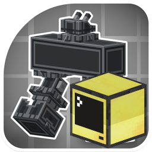

# Let It Walk: ComputerCraft Addon (`letitwalk_cc`)

<p align="center">
  
</p>

[]()
[]()
[]()
[]()

A NeoForge 1.21.1 addon for [Let It Walk](https://modrinth.com/mod/let-it-walk) that turns walking mechs and contraptions into fully programmable, autonomous units controlled via **ComputerCraft: Tweaked**.

**Authors:** CutCatRamen, Antigravity

---

## Features

- **On-Board Peripheral Control**: Directly hook a CC Computer or Wired Modem to existing **Pilot Controls** or **Walker Core** block entities.
- **Remote Station Control**: A dedicated **Walker Computer Interface** (`letitwalk_cc:walker_interface`) block that links to any walker core with a right-click, enabling long-range remote telemetry and piloting.
- **42 Lua Functions**: Full access to locomotion (throttle, steering, stepping, turning), transmission (gears 1-5), modes (crab walk, gallop), hull leaning, suspension jumps, flight thrusters, magnetic foot locking, and real-time 3D telemetry (position, orientation, velocity, RPM, fuel).
- **Tick-Synchronized Input Engine**: Keeps input keys active and refreshed every server tick so movement is completely smooth.
- **Turnkey Lua Programs Included**:
  - `lua/walker_pilot.lua`: Interactive color cockpit HUD with keyboard steering and mode toggles.
  - `lua/walker_auto.lua`: Autonomous waypoint navigation script with heading calculations and auto-jump obstacle avoidance.

---

## Repository Structure

```
letitwalk_cc/
├── src/
│   └── main/
│       ├── java/dev/letitwalk/computercraft/
│       │   ├── LetItWalkCC.java                 # Mod initialization & capability hooks
│       │   ├── WalkerPeripheral.java            # CC IPeripheral implementation (42 functions)
│       │   ├── block/
│       │   │   ├── WalkerInterfaceBlock.java       # Interface block
│       │   │   ├── WalkerInterfaceBlockEntity.java # NBT UUID link storage
│       │   │   └── WalkerInterfaceItem.java        # Linkable block item
│       │   └── registry/
│       │       └── ModBlocks.java               # Deferred registers (blocks, items, BE, tab)
│       └── resources/
│           ├── META-INF/neoforge.mods.toml      # Mod metadata & dependencies
│           ├── pack.mcmeta
│           ├── icon.png                         # Mod logo
│           ├── assets/letitwalk_cc/             # Models, textures, blockstates, lang
│           └── data/letitwalk_cc/               # Crafting recipes & tags
├── lua/
│   ├── walker_pilot.lua                         # Keyboard cockpit HUD
│   └── walker_auto.lua                          # Autonomous waypoint navigation
├── icon.png                                     # Mod logo
├── build.gradle                                 # NeoForge ModDevGradle configuration
├── gradle.properties
├── settings.gradle
└── README.md
```

---

## Building from Source

This mod uses standard **Gradle** with the **NeoForge ModDevGradle** plugin. All dependencies (Create, Let It Walk, Sable, CC: Tweaked) are resolved automatically via Maven, so it compiles cleanly on **any PC (Windows, macOS, Linux)** with Java 21:

### On Windows:
```cmd
gradlew.bat build
```

### On Linux / macOS:
```bash
./gradlew build
```

The resulting mod JAR will be located at:
```
build/libs/letitwalk_cc-1.0.0.jar
```

---

## Getting Started in Game

1. Place `letitwalk_cc-1.0.0.jar` and `cc-tweaked-1.21.1-forge-*.jar` into your Minecraft `mods` folder.
2. **On-Board Setup**:
   - Place a CC Computer directly adjacent to the **Pilot Controls** or **Walker Core**.
3. **Remote Setup**:
   - Craft a **Walker Computer Interface** (`letitwalk_cc:walker_interface`).
   - Right-click an assembled Walker Core with the interface item to link them.
   - Place the interface block anywhere in the world and place a CC Computer adjacent to it.
4. Run `walker_pilot` or `walker_auto <x> <z>` from the computer terminal!

---

## Lua API Quick Reference

```lua
local walker = peripheral.find("walker")

-- Locomotion
walker.setDrive(1.0, 0.0)      -- Full forward
walker.forward(20)             -- Drive forward for 20 ticks
walker.turn(90, 10)            -- Turn 90 degrees right over 10 ticks
walker.step("forward", 20)     -- Take one step forward
walker.stop()                  -- Immediate halt

-- Transmission & Modes
walker.setGear(2)              -- Set gear 1..5
walker.toggleCrabWalk()        -- Toggle lateral strafe mode
walker.setGallop(true)         -- Sprint gallop
walker.jump(25)                -- Charge suspension and jump
walker.setLean(10, -5)         -- Lean chassis (roll, pitch)

-- Telemetry
local x, y, z = walker.getPosition()
local yaw, pitch, roll = walker.getOrientation()
local vx, vy, vz = walker.getVelocity()
local status = walker.getStatus() -- Full telemetry table
```
